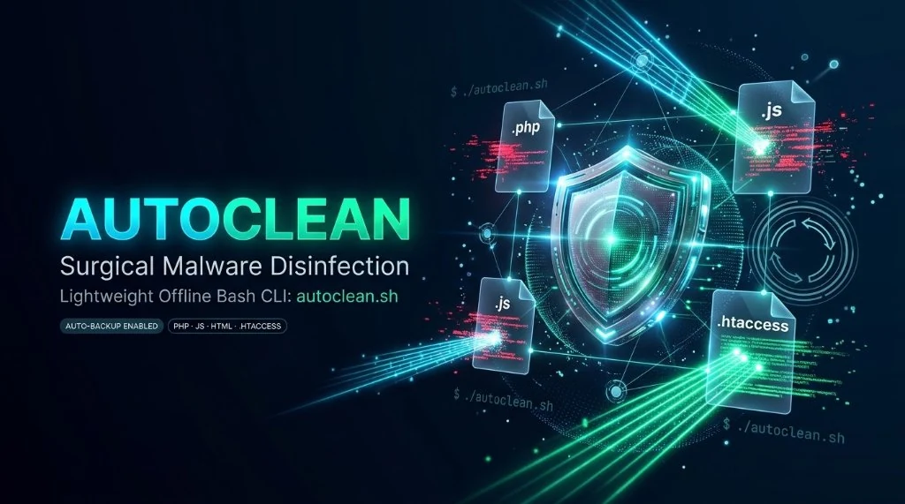

[🇺🇸 English](README.md) | [🇧🇷 Português (BR)](README-ptbr.md) | 🇪🇸 **Español**

# autoclean — Escáner y Limpiador Seguro de Inyecciones de Malware Web

[](LICENSE)
[](https://github.com/sr00t3d/autoclean/releases)
[](autoclean.sh)



**`autoclean.sh`** es una CLI ligera y offline en Bash para detectar y eliminar quirúrgicamente inyecciones de malware web en archivos PHP, HTML, JavaScript y `.htaccess`, con **modo dry-run por defecto**, **respaldo automático `.tar.gz` (`chmod 600`)**, soporte opcional para revendedores cPanel, reglas JSON personalizadas y salidas `table`, `json` y `csv`.

> **Inspiración Histórica:** Reimplementación limpia en Bash + Python 3 stdlib inspirada en `autoclean 1.2` (2011, **Patrick Harrison** / HostGator Security).

---

## Ejecución Directa (Linux / macOS)

```bash
bash <(curl -fsSL https://raw.githubusercontent.com/sr00t3d/autoclean/main/autoclean.sh) -d /var/www/html --exit-code
```

---

## Instalación y Uso

```bash
git clone https://github.com/sr00t3d/autoclean.git
cd autoclean
chmod +x autoclean.sh

./autoclean.sh -d /home/usuario/public_html
./autoclean.sh -d /home/usuario/public_html --clean
./autoclean.sh -d /var/www/html -o json --exit-code
```

---

## Autor & Licencia

Desarrollado por **Percio Castelo** ([perciocastelo.com.br](https://perciocastelo.com.br)).
Inspirado en `autoclean 1.2` (2011, **Patrick Harrison** / HostGator Security).

Licenciado bajo la [Apache License 2.0](LICENSE).
